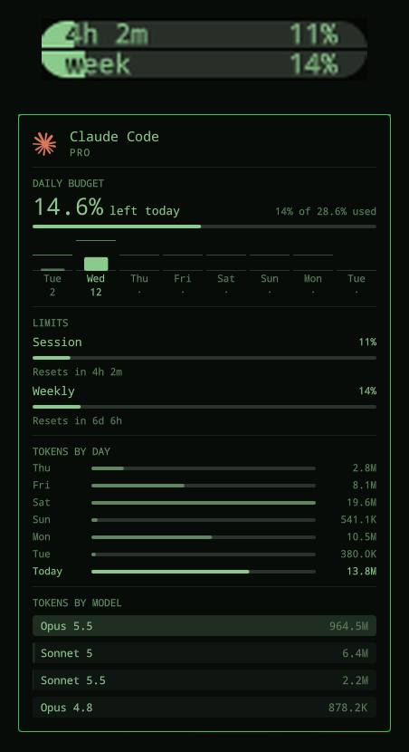
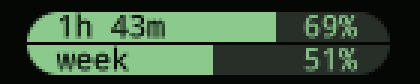

# Agents Budget



The Omarchy **Agents** bar widget with two additions for Claude Code users:

- **A usage pill in the bar.** Claude's 5-hour session on top, the weekly
  limit below, each with its percentage inside. The session half is labelled
  with the time until it resets. The text inverts where the fill covers it,
  like a phone battery.
- **A battery view with 5h momentum.** Today's budget as one battery, with
  a strip underneath that shows how fast the 5h session is burning.
- **A daily budget in the panel.** Your weekly limit split into a running
  daily allowance, so you can pace a week of work instead of finding out on
  day five that it is gone.

Everything else is the stock Agents panel: limits, tokens by day, tokens by
model, Codex and Fireworks tabs, cross-machine sync.

## Install

Requires Omarchy 4 (tested on 4.0.6) and a signed-in Claude Code CLI.

```bash
omarchy plugin add https://github.com/TonciZ/omarchy-agents-budget.git --enable
```

This replaces the stock widget, so turn that one off or you get two icons:

```bash
omarchy plugin disable omarchy.agents
```

Remove it again with `omarchy plugin remove io.github.tonciz.agents-budget`
and bring the stock one back with `omarchy plugin enable omarchy.agents`.

## The bar pill

```
╭ 2h 14m ████████░░░░░  63% ╮
╰ week   ██░░░░░░░░░░░  13% ╯
```

| Half | Yellow from | Red from |
|---|---|---|
| 5h session | 70% | 80% |
| week | 85% | 90% |

The panel's limit meters and the bar's alarm use the same thresholds. Yellow
comes from your theme's `yellow` (or `color3`) in `colors.toml`, red from its
urgent color, so the pill follows theme changes.

Without Claude limits (signed out, no record yet) or on a vertical bar the
button falls back to the plain icon.

### Battery view

Switch on **Left today in the bar** in the panel's budget section (or middle
click the pill) and the pill becomes one battery for today's budget. It is
full when the day starts and empties from the left as you use it, like a
phone battery, with the number in the middle.

```
╭░░░░░░░░░░ 7.9% ███████████╮
╰───────────────────────────╯
```

**Count today from 100** picks the number on it. Off, it is the actual weekly
percent left for today (14% budget, half used: `7%`). On, today's budget is
split into 100 parts and it counts down from `100` to `0` (same day: `50`).
Past the budget it reads `over` in red. Both switches are kept in
`~/.local/state/omarchy/agents/view.json`.

### 5h momentum strip

In the battery view a thin strip along the bottom of the pill shows the
5-hour session, so you can see how fast you are burning it without opening
the panel. The fill is the session percent used, and the end of the fill
tells you the pace of the last 15 minutes against the speed that would land
exactly on 100% at the reset:

```
╭░░░░░░░░░░░░ 62 █████████████╮
╰▀▀▀▀▀▀▀▀▀▀▀▀▀▀›››►──────────╯
```

| End of the fill | Pace vs what lasts until the reset | Color |
|---|---|---|
| `›››` point | 2x or more | red |
| `››` point | 1.4x to 2x | yellow |
| `›` point | 1.1x to 1.4x | normal |
| flat, with a tick | 0.8x to 1.1x (on pace) | normal |
| `‹` / `‹‹` / `‹‹‹` notch | under 0.8x / 0.5x / 0.2x (idle reads `‹‹‹`) | normal |

The chevrons are cut out of the fill, and the whole line takes their color,
or the 5h limit's own yellow/red at 70/80% if that is louder. When you are
on pace the line ends flat and a small gap marks how much of the 5 hours has
gone by: fill past the gap means you are using it faster than it lasts.

The pace needs about 5 minutes of readings first, and they are kept in
memory only, so the chevrons stay away for a few minutes after the shell
restarts. With no active session the strip is hidden.

## Pill views

Every look the bar pill can have, captured from a live bar.



**Split view** (default). 5h session on top, labelled with the time to its
reset, and the week below. Each half fills left to right and turns yellow,
then red, as it gets close to its limit (here the 5h is at 69%).


**Battery view, actual percent.** Middle click the pill. One battery for
today's budget, showing how much of the weekly limit is left for today
(6.1%). The strip underneath is the 5h session. On pace it ends flat, and
the small gap marks how much of the 5 hours has gone by.


**Battery view, counting from 100.** Same battery with **Count today from
100** on: today's budget split into 100 parts, counting down to 0.


**`›››` Burning at 2x or more.** The last 15 minutes used the 5h session at
least twice as fast as what lasts until its reset. The whole line turns red.


**`››` Burning at 1.4x to 2x.** Heading for the 5h limit before it resets.
The line turns yellow.


**`›` Slightly fast, 1.1x to 1.4x.** Normally the line keeps its usual
color. It is yellow here only because this session had already reached 70%,
and the limit warning wins over a calm pace.


**`‹` Slower, under 0.8x.** You have room to spare. Same 70% warning color
as above.


**`‹‹‹` Barely using it, under 0.2x.** This is also what an idle session
looks like. (`‹‹` sits between, under 0.5x.)

## The daily budget

Each calendar day gets a seventh of the weekly limit, and whatever you do not
use carries forward in full. Use 2% on Tuesday and Wednesday has 26.6% to
spend (14.3 + 12.3).

- **The big number** is what is left for today: everything allowed up to the
  end of today, minus everything used this week. Past it, it turns red and
  shows how far over you are.
- **The graph** has a column per day of the weekly window. The bar is what
  that day used. The tick is what the day had available (its seventh plus
  anything carried in). Days ahead show what they get if every day before
  them ends exactly on budget.
- **The reset day.** Claude's week runs from the reset hour to the same hour
  seven days later, which touches eight calendar days. The seven sevenths go
  to the day the window opened through the day before the reset. The reset
  day itself lives on whatever you saved.

Days run midnight to midnight in local time. The headline numbers only need
the current weekly percentage, so they are right from the first minute. The
per-day bars need to know the weekly percentage at the start of each day,
which the widget records in
`~/.local/state/omarchy/agents/budget.json` (honours `XDG_STATE_HOME`). A day
the shell never ran on gets merged into the next day it does run. The budget
is shown for Claude only.

## Settings

Settings live in the widget's entry in `~/.config/omarchy/shell.json`:

```bash
omarchy bar set io.github.tonciz.agents-budget refreshIntervalSec 30 --json
```

| Key | Default | What it does |
|---|---|---|
| `refreshIntervalSec` | `60` | How often the usage records regenerate (the stock widget uses 900) |
| `providers` | all enabled | `{"claude": {"enabled": true}, "codex": {...}, "fireworks": {...}}` |
| `syncMode` | `"Off"` | `"On"` writes this machine's snapshot and merges the others |
| `syncDir` | `""` | A folder synced by Syncthing, Dropbox, rsync, ... |
| `syncFileName` | `<hostname>.json` | This machine's snapshot file |
| `syncDeviceId` | hostname | Stable device name inside the snapshot |

## Interactions

- Bar: left click opens the panel, right click launches your default agent
  (`omarchy default agent claude`), middle click switches the battery view.
- Panel: `h`/`l` switch subscription, `j`/`k` scroll, `r` or Enter refresh,
  Esc closes.
- IPC: `omarchy-shell io.github.tonciz.agents-budget <open|close|toggle|refresh|next>`.

## How it works, and what can break

This is a clone of Omarchy's first-party `omarchy.agents` plugin
(`omarchy plugin clone`). `Main.qml` and `Agent.qml` are unchanged from
Omarchy 4.0.6; the bar pill, colors and budget are all in `Panel.qml`. The
data comes from Omarchy's own collectors (`omarchy-agent-usage-update` and
the per-agent `omarchy-agent-usage-*` scripts), which write one JSON record
per agent to `~/.local/state/omarchy/agents/usage/`.

It uses Omarchy's internal shell components (`qs.Commons`, `qs.Ui`), which
are not a promised API. An Omarchy update can rename something this plugin
relies on, and fixes Omarchy makes to its own Agents widget do not reach this
copy. If the widget stops loading after an update, check
`journalctl --user -u omarchy-shell` and open an issue.

## Credits

Based on the Agents plugin from [Omarchy](https://github.com/omacom/omarchy)
by David Heinemeier Hansson and contributors, MIT licensed. See `LICENSE`.
